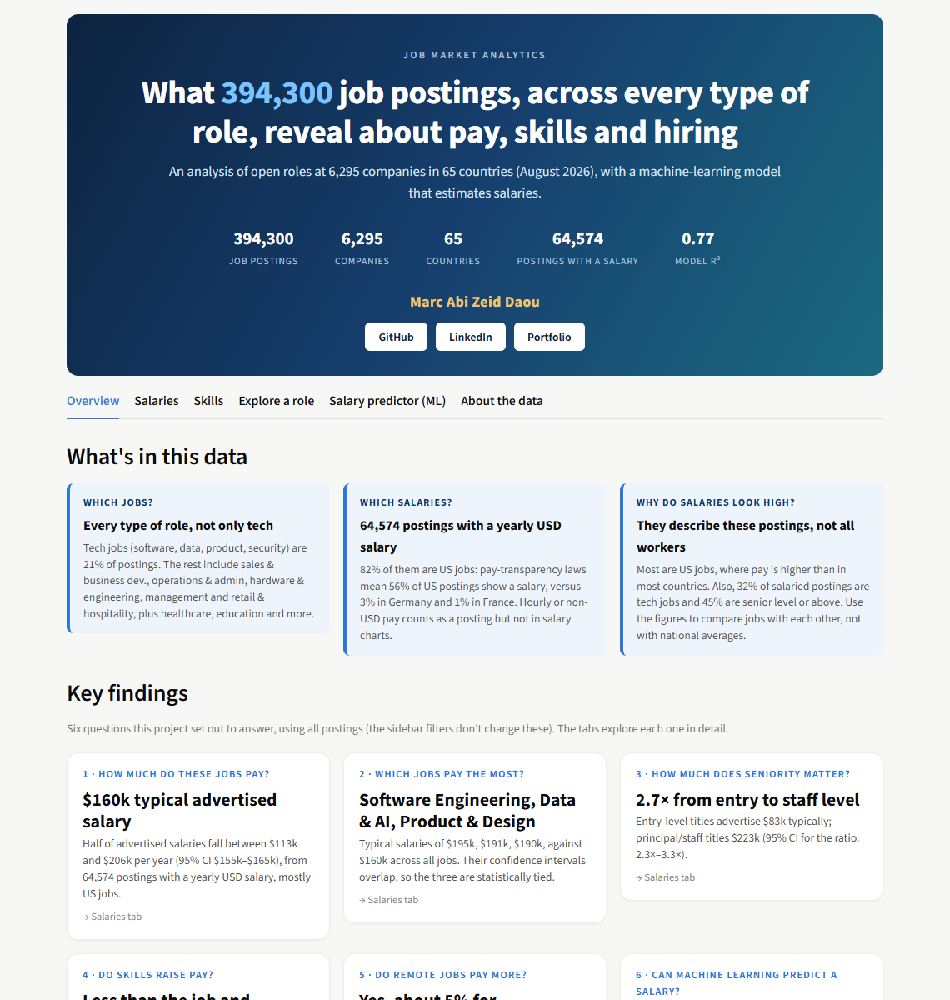

# Job Market Analytics

An end-to-end analysis of **394,300 job postings across every type of role** (software, data, sales,
engineering, operations, healthcare, retail and more) from 6,295 companies in 65 countries, with a
machine-learning salary model that explains **77% of the variance in advertised salaries** on held-out data.

**Which jobs and which salaries?** Tech roles (software, data, product, security) are 21% of postings; the
other 79% span every other field. Salary figures use the 64,574 postings that list a yearly USD salary;
82% of those are US jobs, 32% are tech jobs and 45% are senior level or above, so they describe these
postings rather than national averages.

**[Open the live dashboard →](https://job-market-analysis-ndmqelnezlfa64hyyhhwkv.streamlit.app)** ·
**[Read the report (PDF) →](report/report.pdf)**
Everything is precomputed and committed, so the dashboard opens with no setup.

[](https://github.com/marcazdaou/Job-Market-Analysis/actions/workflows/tests.yml)


[](https://job-market-analysis-ndmqelnezlfa64hyyhhwkv.streamlit.app)

---

## The questions, and what the data says

| # | Question | Answer |
|---|---|---|
| 1 | How much do these jobs pay? | Typical (median) advertised salary is **$160k** (95% CI $155k–$165k); half fall between $113k and $206k. |
| 2 | Which jobs pay the most? | **Software Engineering ($195k), Data & AI ($191k), Product & Design ($190k)**, then Security ($188k). Their confidence intervals overlap, so the top four are statistically tied. |
| 3 | How much does seniority matter? | **2.7×** (95% CI 2.3×–3.3×) from entry level ($83k) to principal/staff ($223k); Senior/Lead $170k, Director/Executive $204k. |
| 4 | Do skills raise pay? | Jobs asking for PyTorch pay $220k typically, but once title, company and city are accounted for, **a single skill shifts pay by at most 4%**. The job and the employer matter far more. |
| 5 | Do remote jobs pay more? | Remote postings advertise **+9.8%** more, but about half of that is job mix: comparing similar jobs **within the same company**, the premium is **+4.7%** (95% CI +2.5% to +6.9%). |
| 6 | Can machine learning predict a salary? | **Yes:** on 10,972 unseen jobs the model explains 77% of pay differences (R² 0.77), with a typical error of 11%. |

Pay transparency shapes the data: 27% of postings show a salary, 56% in the US versus 3% in Germany and
1% in France. The dashboard opens with these six answers and lets you explore each one interactively; the
**[report](report/report.pdf)** gives the full methods and results.

---

## Dashboard

| Tab | What it shows |
|---|---|
| **Overview** | The six key findings, headline numbers, an interactive world map of postings and pay, in-demand job types, and a "who hires vs. who pays" company chart |
| **Salaries** | Salary distribution with a "compare your salary" marker; typical pay and spread by job type, seniority, city and industry; remote vs. on-site pay gap |
| **Skills** | Skill explorer (pick a skill → demand, pay, paired skills, roles); most requested skills; best-paid skills; ML estimate of each skill's own effect on pay |
| **Explore a role** | Search any job title, or compare two side by side: pay distribution, skills, best-paying companies, and the latest postings with links |
| **Salary predictor (ML)** | Describe a job → estimated salary, likely range, and where it sits among similar real jobs; full model evaluation |
| **About the data** | Source, preparation steps, model method, and a searchable table of postings |

Sidebar filters (role family, seniority, country, remote/on-site, employment type) apply to every tab
except the predictor. Tooltips add context (pay, remote share, top skill) rather than repeating labels,
and every chart has a "View data table" option.

---

## Data

**Source:** `zalizedata/tech-job-postings-salary-dataset` (CC BY-NC 4.0): job postings collected from
public company career pages (SmartRecruiters, Greenhouse, Ashby, Lever, Workable), covering roles open
in August 2026.

**Cleaning** (`pipeline/collector.py`, rules in `pipeline/features.py`):

| Salary status | Postings |
|---|---:|
| No salary listed | 287,149 |
| **Usable annual USD salary** | **64,574** |
| Another currency, or hourly/monthly pay | 42,029 |
| Range wider than 4× (uninformative) | 303 |
| Midpoint outside $20k–$1M (hourly rate mislabeled as annual, or typo) | 200 |
| Invalid range (min ≤ 0 or max < min) | 45 |

- All postings count toward volumes, role mix and skill demand. Salary statistics use only the 64,574
  usable annual USD ranges; other currencies and pay periods are **excluded, not converted**, so no
  exchange-rate or hours-per-year assumption is introduced.
- Salary = midpoint of the advertised range. Medians are reported because pay is right-skewed.
- **Role family** (19 job types) and **seniority** (5 levels) are inferred from job-title keywords using
  transparent, ordered regex rules, with French, German, Spanish and Dutch keywords for non-English
  titles. 86% of postings (96% of those with a salary) match a job type; the rest have very generic or
  less common-language titles and are left out of job-type charts only.

---

## Machine learning

**Task:** predict the advertised annual salary of a posting.
**Target:** `log(salary midpoint)`, so errors are proportional (a $20k miss matters more at $60k than at $400k).

**Features:** title text (TF-IDF unigrams + bigrams), company, industry, department, city, country,
employment type, remote flag, skills (binary flags), and title-derived seniority / role family.

**Evaluation protocol (designed to avoid leakage):**
1. The same job is often posted in many cities with an identical salary range. These copies are collapsed
   (64,574 → 54,859) so a test row can never be a duplicate of a training row.
2. 20% is held out as a test set and not touched until the end.
3. Candidates are compared with 5-fold cross-validation on the remaining 80%; the lowest CV error wins.
4. The winner is scored once on the test set, and again on a split where **entire companies** are held out.
5. An 80% prediction interval is built from out-of-fold residuals (split-conformal style) and its
   coverage is checked on the test set.

**Results** (dollar scale):

| Model | CV R² | Test R² | Test MAE |
|---|---:|---:|---:|
| Median baseline | −0.004 | −0.003 | $55,869 |
| Ridge: title + location only (previous version of this project) | 0.586 | 0.611 | $31,437 |
| Gradient boosting (target-encoded categoricals) | 0.645 | 0.673 | $28,767 |
| **Ridge: full feature set (selected)** | **0.737** | **0.771** | **$24,047** |

| Metric | Value |
|---|---:|
| Test R² (log scale) | 0.806 |
| Median absolute % error | 11.1% |
| 80% interval coverage on test set | 80.9% |
| R² on companies never seen in training | 0.496 |

The linear model beats gradient boosting here, plausibly because most of the signal sits in thousands of
sparse title words and company identities, which a regularized linear model handles directly.

**Permutation importance** (drop in test R² when one input is shuffled): title 0.58, company 0.40,
department 0.06, industry 0.05, city 0.03, skills 0.01.

---

## Statistical inference

`analysis/salary_statistics.py` attaches uncertainty to the headline findings.

**Confidence intervals.** Postings from one company share pay bands and are often copied across cities,
so they are not independent. Intervals for medians therefore use a **company cluster bootstrap**
(1,000 replicates, each resampling whole companies). Example: overall median $160k (95% CI $155k–$165k);
Healthcare $140k (95% CI $103k–$195k), wide because just five companies post 34% of its salaried jobs.

**Remote vs. on-site: a fair comparison.** OLS regressions of log salary on a remote indicator, adding
controls step by step, with company-clustered standard errors (de-duplicated postings, n = 52,749):

| Comparison | Remote pay difference | 95% CI | p-value |
|---|---:|---:|---:|
| Raw difference | +9.8% | +3.5% to +16.4% | 0.002 |
| + job type & seniority | +5.3% | +0.5% to +10.2% | 0.029 |
| + country & employment type | +6.2% | +1.3% to +11.4% | 0.013 |
| **+ same company (fixed effects)** | **+4.7%** | **+2.5% to +6.9%** | **<0.001** |

**Are the job types right?** (`analysis/label_validation.py`) Most postings also carry a department chosen
by the employer ("Engineering", "Sales", "People"…), which is independent of the title rules. On 117,772
postings from 4,706 companies, the title-based job type matches the employer's department **85% of the time**
(95% CI 85.0%–85.4%); about 90% or more for Software, Data & AI, Product & Design, Sales, Marketing and
Research. The check also caught a real error: titles like "Sales Engineer" and "Technical Support Engineer"
had been labeled engineering jobs because of the word "engineer"; they are now sales and support jobs.
Cross-functional types (operations, consulting, management) sit in every department, so they are not scored.

**Scope:** salaries are the ranges employers advertise; most salaried postings are from the US, where
pay-transparency laws require ranges; role family and seniority come from title keywords; skill–pay
relationships are associations rather than cause and effect; for employers outside the training data the
model scores R² 0.50; jobs that usually pay by the hour (retail, hospitality, trades) have few yearly
salaries, so the predictor flags its estimates for them as less reliable; pay gaps between groups (e.g.
remote vs. on-site) can partly reflect a different mix of jobs in each group.

---

## Project structure

```
├── pipeline/
│   ├── features.py        # Shared rules: salary cleaning, role family, seniority, model inputs
│   └── collector.py       # Step 1: raw parquet -> data/jobs_clean.parquet + data_summary.json
├── models/
│   ├── train.py           # Step 2: compare models, evaluate, save the winner
│   ├── salary_model.pkl   # Trained model (committed)
│   └── model_meta.json    # Metrics, comparison, chart data (committed)
├── analysis/
│   ├── salary_statistics.py # Step 3: bootstrap confidence intervals + remote-pay regressions
│   ├── label_validation.py  # Checks job types against employers' own departments
│   └── results/             # statistics.json, label_validation.json (committed)
├── report/
│   ├── build_report.py      # Step 4: builds the PDF report from the result files
│   └── report.pdf           # The written report
├── dashboard/
│   └── app.py               # Streamlit dashboard (reads committed artifacts only)
├── data/
│   ├── jobs_clean.parquet   # Cleaned postings, 11 MB (committed)
│   └── data_summary.json    # Cleaning funnel (committed)
├── tests/                   # pytest: rules, data integrity, model calibration, dashboard smoke test
├── .github/workflows/       # Runs the tests on every push
├── docs/dashboard.png       # README screenshot
├── .streamlit/config.toml   # Dashboard theme
├── check_data.py            # Quick profile of the raw file
├── setup.py                 # Rebuild data + model from raw data and launch
├── requirements.txt         # Dashboard dependencies, pinned (the model pickle is version-specific)
└── requirements-dev.txt     # + statsmodels, matplotlib, pytest for analysis, report and tests
```

---

## Run locally

```bash
git clone https://github.com/marcazdaou/Job-Market-Analysis.git
cd Job-Market-Analysis
pip install -r requirements.txt
streamlit run dashboard/app.py
```

**To rebuild everything from raw data:** place the source file at
`data/tech_jobs_2026/jobs_large.parquet`, then:

```bash
pip install -r requirements-dev.txt
python pipeline/collector.py          # clean the data          (~30 s)
python models/train.py                # train and evaluate      (~2 min)
python analysis/salary_statistics.py  # confidence intervals    (~30 s)
python analysis/label_validation.py   # job-type check          (~5 s)
python report/build_report.py         # rebuild the PDF report (needs Chrome or Edge)
pytest                                # run all tests
```

---

## Author

**Marc Abi Zeid Daou**, Data Analytics Engineering, Northeastern University
[LinkedIn](https://www.linkedin.com/in/marc-abi-zeid-daou/) · [GitHub](https://github.com/marcazdaou) · [Portfolio](https://marcazdaou.github.io/my-portfolio/)
